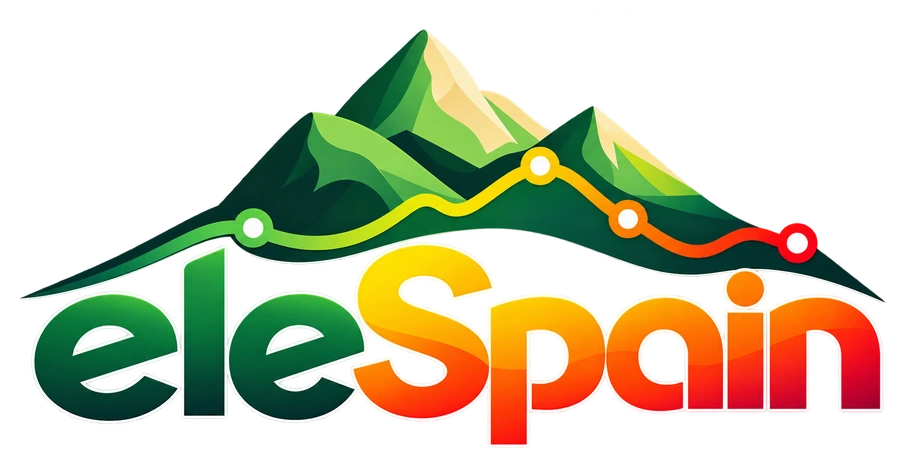

  
  
Herramientas de análisis de elevaciones de OpenStreetMap frente al MDT05 de España y Andorra.

  
<a href="https://atarom.github.io/eleSpain/">Abrir aplicación</a>

---

**eleSpain** permite comparar las etiquetas `ele=*` de nodos, vías y relaciones de OpenStreetMap con las elevaciones del terreno. También permite consultar la altura de un nodo, obtener perfiles de vías OSM y dibujar perfiles directamente sobre el mapa.

Utiliza **OpenLayers WebGL** y ofrece tres fuentes de elevación: **IGN XYZ**, **COG remoto de Hugging Face** y **COG local**. El archivo GeoTIFF local se lee directamente desde el navegador, sin subirlo a ningún servidor.

**QA por zona:** configura el umbral de diferencia y, si lo necesitas, añade filtros Postpass además del requisito `ele=*`. Después, analiza la zona visible.

**Elemento OSM:** consulta un nodo o una vía por ID, o selecciónalos desde el mapa. Se muestran las elevaciones, diferencias, perfiles y pendientes disponibles. También se pueden consultar versiones históricas.

**Dibujar perfil:** pulsa sobre el mapa para añadir vértices y obtener un perfil con las elevaciones de cada punto, sin interpolación.

En **Ajustes** puedes configurar cada fuente de elevación de forma independiente y seleccionar el archivo local `Spain_MDT05_INT16_WGS84.tif` cuando utilices COG local. Este archivo, de aproximadamente 4,72 GB, **no está incluido en el repositorio**.

## Datos y tecnologías

- **Datos OSM:** [OpenStreetMap](https://www.openstreetmap.org/copyright), [API de OSM](https://wiki.openstreetmap.org/wiki/API_v0.6), [Postpass (Geofabrik)](https://postpass.geofabrik.de/) y [Overpass API](https://wiki.openstreetmap.org/wiki/Overpass_API).
- **Modelo de elevaciones:** [MDT05 del IGN/CNIG](https://centrodedescargas.cnig.es/), [teselas IGN XYZ](https://xyz-mdt.idee.es/) y [COG de MDT05 en Hugging Face](https://huggingface.co/datasets/aTaromOCD/Spain_MDT05_INT16_WGS84).
- **Aplicación:** [OpenLayers](https://openlayers.org/) y [geotiff.js](https://geotiffjs.github.io/).

Las discrepancias de elevación son indicios para control de calidad, no errores confirmados.
